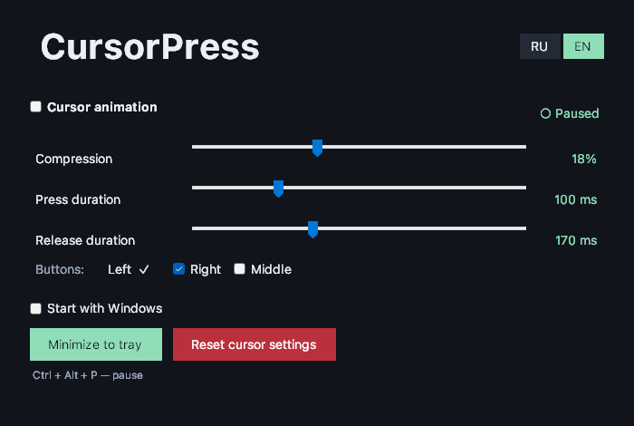

# CursorPress

Smooth cursor compression on click. Uses your Windows cursor scheme.

[Русский](README.md) · **English**



## Get started

Requires Windows 10/11 and [.NET Desktop Runtime 8](https://dotnet.microsoft.com/download/dotnet/8.0).

1. Open `CursorPress.exe`.
2. Adjust compression and animation speed.
3. Enable **Cursor animation**.

## Controls

- **Ctrl + Alt + P** — toggle the effect.
- **Close button** — hide to tray and remove from the taskbar.
- **Double-click the tray icon** — open settings.
- **Exit in the tray menu** — quit.
- **Reset cursor settings** — disable the effect and reload your Windows cursor scheme. Slider values stay unchanged.

Includes optional startup and a RU / EN switch.

## Build

Requires .NET SDK 8.

```powershell
dotnet publish -c Release --no-self-contained -o dist\CursorPress
.\dist\CursorPress\CursorPress.exe
```

Copy the entire `dist\CursorPress` folder. Tests: `--self-test`, `--smoke-test`. Standalone cursor recovery: `Restore-Cursors.cmd`.

## Compatibility

Games and apps with custom cursors may not be supported. Animated `.ani` and legacy monochrome cursors have animation and antialiasing limitations. Disable the effect before changing your cursor scheme or pointer size.

Settings are saved to: `%LOCALAPPDATA%\CursorPress\settings.json`.
