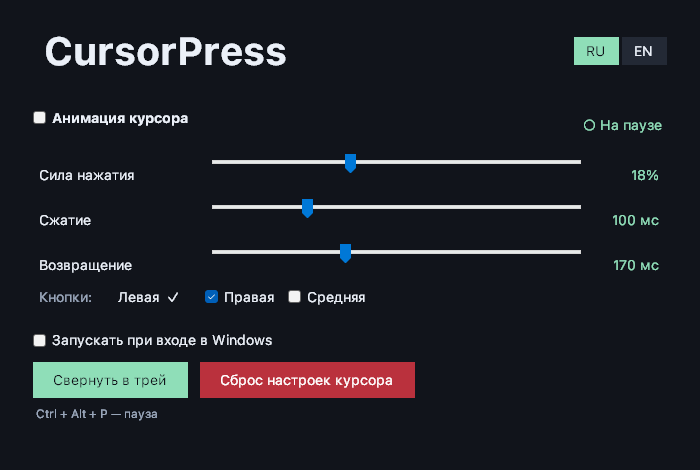

# CursorPress

Плавное сжатие курсора при клике. Работает с твоей схемой Windows.

**Русский** · [English](README.en.md)



## Запуск

Нужны Windows 10/11 и [.NET Desktop Runtime 8](https://dotnet.microsoft.com/download/dotnet/8.0).

1. Запусти `CursorPress.exe`.
2. Настрой силу и скорость сжатия.
3. Включи **«Анимация курсора»**.

## Управление

- **Ctrl + Alt + P** — включить / выключить эффект.
- **Крестик** — свернуть в трей, убрать из панели задач.
- **Двойной клик по значку трея** — открыть настройки.
- **Выход в меню трея** — завершить программу.
- **Сброс настроек курсора** — выключить эффект и перезагрузить схему Windows. Ползунки не сбрасываются.

Есть возможность автозагрузки и переключатель RU / EN.

## Сборка

Нужен .NET SDK 8.

```powershell
dotnet publish -c Release --no-self-contained -o dist\CursorPress
.\dist\CursorPress\CursorPress.exe
```

Скопируйте всю папку `dist\CursorPress`. Тесты: `--self-test`, `--smoke-test`. Отдельное восстановление курсоров: `Restore-Cursors.cmd`.

## Совместимость

Игры и приложения с собственными курсорами могут не поддерживаться. У `.ani` и старых монохромных курсоров есть ограничения анимации и сглаживания. Перед сменой схемы или размера указателя выключите эффект.

Настройки сохраняются в: `%LOCALAPPDATA%\CursorPress\settings.json`.